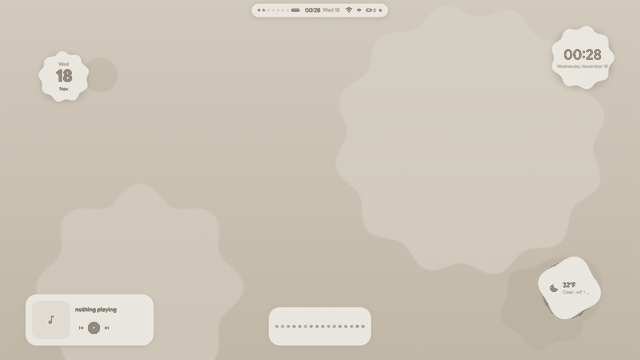
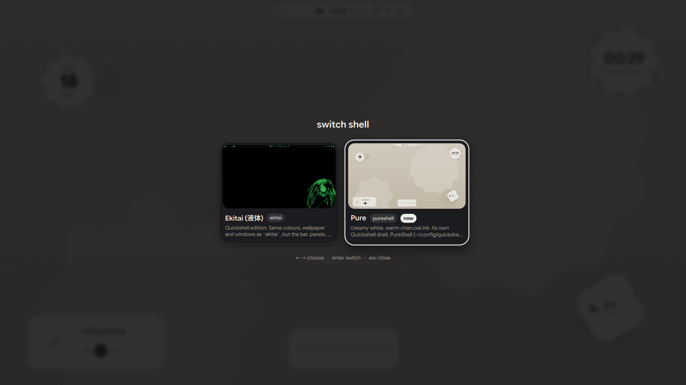

<h1 align="center">ShellSwitcher</h1>

<p align="center"><b>Change your whole desktop in a second, without it ever blinking.</b><br>
Free, and made for <a href="https://quickshell.org">Quickshell</a> on Hyprland.</p>

<p align="center"></p>

You've built more than one shell. One for focus, one for fun, one you're still tinkering with. Switching between
them usually means killing one, starting another, and watching your bar vanish, your wallpaper flash and your
notifications go missing for a moment.

ShellSwitcher makes it feel like flipping a page. Press `SUPER + ALT + S`, pick one, and your desktop simply
becomes the other one.

## See them all, as you left them

Every shell you have is a card, showing what it looked like the last time you used it, so you're choosing by
sight, not by name. The one you're on is marked. Arrow keys or the mouse to choose, Enter to go, Esc to stay.

<p align="center"></p>

## No blink, no blank bar

The trick: the moment you pick, the switcher covers your screen with a picture of it exactly as it was. Behind
that, the old shell steps out and the new one comes in: its bar, its wallpaper, its colours, your terminal's
colours too. It waits until the new shell is truly up and drawn, then lets the picture melt away. You never see
the in-between.

It runs on its own, apart from every shell, so it's still there while one goes and the next arrives, and it
quits when it's done. Nothing stays running in the background.

## Made for themes with a light and a dark side

A theme can have versions (PureShell's light and dark): they share one card, and it knows which you're in.

## Get it

ShellSwitcher is part of my [dotfiles](https://github.com/BugzySleeps/bugzysdotfiles), whose `rice` theme switcher
does the swapping. Its shells so far: [liquid](https://github.com/BugzySleeps/liquid), a glowing liquid shell, and
[PureShell](https://github.com/BugzySleeps/PureShell), a calm cream one.

```sh
qs -c switcher        # open it (the dotfiles bind it to SUPER + ALT + S)
```

Any rice theme with `quickshell = "<config>"` in its `theme.toml` gets a card on its own.

**Needs:** Quickshell (Qt 6.9+), Hyprland, `rice` from the dotfiles, `grim`, and Google Sans Flex (in the
dotfiles' fonts).

## Licence

Free to use and to change for yourself, not to copy into other projects or republish. See [LICENSE](LICENSE).
